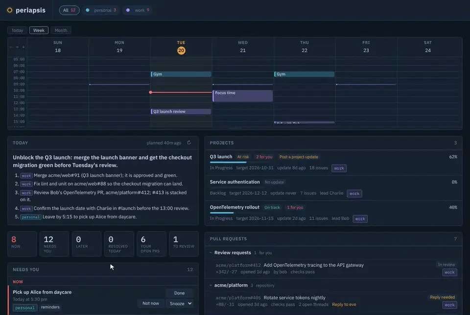
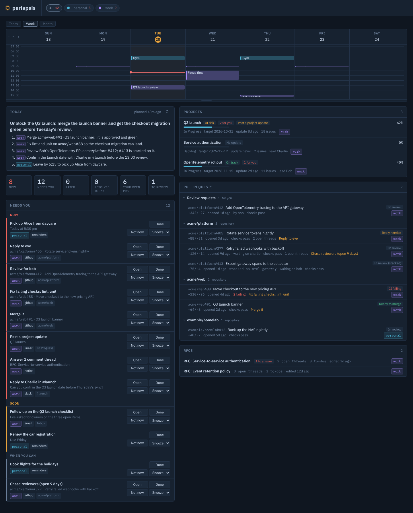
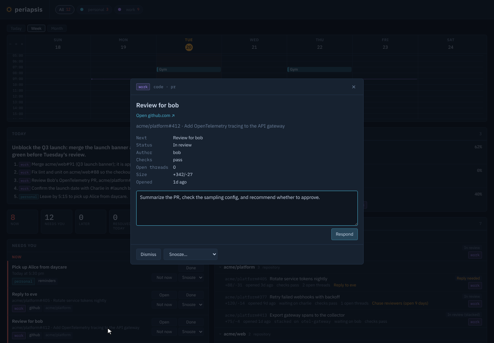

# periapsis

periapsis gathers status items from many machines into one dashboard. A **reporter** on each
machine reads its configured sources, either directly from a service's API or through the
machine's Claude Code connectors, and publishes what it finds, signed and encrypted, through
a NATS broker. The **hub** opens those snapshots, keeps them in a local database and serves a
dashboard on localhost. From the dashboard you can dismiss, snooze or complete items, have
the hub write a daily plan with Claude, and send a signed prompt back to a machine for its
Claude to act on.



- [Components](#components)
- [How data flows](#how-data-flows)
- [Setup](#setup)
- [Configuration](#configuration)
- [The dashboard](#the-dashboard)
- [Extending](#extending)
- [Develop](#develop)

## Components

| Piece | Runs on | Does |
| --- | --- | --- |
| Reporter (`packages/reporter`) | each reporting machine | Reads sources on a schedule, publishes snapshots, runs prompts sent by the hub when allowed |
| Hub (`packages/hub`) | one machine | Receives snapshots, stores items, serves the dashboard, writes the daily plan, sends prompts |
| Broker (`deploy/`) | AWS EC2 | NATS over secure WebSocket; relays sealed messages |
| Registry (`deploy/`) | AWS S3 + CloudFront | Serves the root-signed list of public keys |
| CLI (`packages/cli`) | operator workstation | Key generation, enrollment, registry signing, broker authorization |

`packages/core` holds the wire contract (item schema, subjects, signing, sealed envelopes,
registry) and `packages/transport` the broker client.

## How data flows

### Keys and trust

- One **root key** (`root.key`) stays on the operator workstation. It signs the registry and
  nothing else.
- Every hub and reporter generates its own **identity** on its own machine: an ed25519
  signing key, an x25519 encryption key and a NATS nkey. Only the public halves leave the
  machine, as a one-line enrollment token.
- The operator adds each token to the **registry**, re-signs it with the root key and
  publishes it to S3. Every hub and reporter verifies the registry against the root public
  key before trusting any key in it; the hub re-reads it every five minutes.
- The broker authorizes each nkey for its own subjects only: a reporter may publish only to
  `status.<account>` and receive only on `commands.<account>`; the hub may receive every
  `status.*` and publish `commands.*`. Reporters never see each other.

### What a reporter reads and sends

Each instance in a reporter's `instances.json` is read one of two ways:

- **direct**: the reporter calls a service's API with credentials on that machine (for
  GitHub, the machine's `gh` login).
- **agent**: the reporter runs the machine's `claude` CLI headless, with only the named
  connector tools allowed and every built-in tool (shell, files, web) and the connector's
  write tools denied. Claude reads through the connectors logged in
  on that machine and returns items as JSON. What it reads is passed to it as data, not
  instructions.

Either way the result is a snapshot per source: a list of items, or a failure note. An item
carries only:

| Field | Limit |
| --- | --- |
| `key`, `kind`, `priority` (1 to 3), `fingerprint` | identifiers and urgency |
| `title`, `detail`, `group` | 300, 600 and 120 characters |
| `body` | up to 16,000 characters, for long text such as a Claude reply |
| `url` | dropped unless it is `https` on an allowlisted host (Slack, Google, Atlassian, Linear, Notion, GitHub, Bitbucket) |
| `meta` | up to 30 short string fields, such as PR status or event times |

The reporter signs each snapshot with its identity, encrypts it to the hub's public key
with a fresh ephemeral key, and publishes it to `status.<account>`. The broker relays
ciphertext; it cannot read or forge a message, and it stores nothing.

### What the hub does with it

The hub decrypts each snapshot, checks the sender's signature against the registry,
rejects stale or replayed messages, validates every field and stores the items in SQLite
(`<dataDir>/hub.db`). An item missing from a source's next snapshot is marked resolved;
resolved items are deleted after 30 days. The dashboard is served on `127.0.0.1` only, and
its actions accept requests only from the dashboard page itself.

### Where Claude runs, and what it sees

| Use | Runs on | Sees | Turned on by |
| --- | --- | --- | --- |
| Agent sources | the reporting machine, as its logged-in Claude | what the allowed connector tools return | an instance with `mode: "agent"` |
| Daily plan | the hub machine, as its logged-in Claude | every account's open items, PRs, today's and tomorrow's events, and counts, in one prompt; no tools | on by default; `"plan": false` turns it off |
| Responses | the reporting machine, with its own Claude settings and permissions | the prompt typed on the dashboard and the item it is about | a `respond` section in that machine's config |

The daily plan is the one place where items from different accounts are combined into a
single Claude call. Claude Code keeps its own session history on whichever machine runs it.

### Prompts back to a machine

A prompt typed on the dashboard is sealed to that account's public key, signed with the
hub's key, and published to `commands.<account>`. The reporter runs it only if the hub's
signature checks out against the registry, the message is fresh and not a replay, it is
addressed to that account, and the machine's config has a `respond` section. It runs one
prompt at a time with `claude` in `respond.cwd`, and reports progress and Claude's reply
back as a task item. A reply to a task continues the same Claude session.

### What is stored where

| Where | What |
| --- | --- |
| Operator workstation | `root.key`, the signed registry, `accounts.conf` |
| S3 registry | the signed registry (public keys and nkeys), `root.pub.json`, `bootstrap.json`, the installer and bundles; all public |
| Broker | nothing; it relays messages |
| Hub machine | `hub-config.json` (its private keys), `hub.db` (items and their status, the latest plan) |
| Reporting machine | `~/.periapsis/config.json` (its private keys), `instances.json`, `respond-state.json` (the last 50 tasks from the past 7 days, with prompts and replies) |

## Setup

Clone and build:

```bash
git clone git@github.com:double-nibble/periapsis.git
cd periapsis
pnpm install && pnpm build
```

### Bootstrapping

Setup involves three kinds of machine, which may be the same box:

* **Operator workstation**: Holds `root.key` and your AWS credentials, and is the only place anything is signed
* **Hub machine**: Runs the hub and serves the dashboard
* **Reporter machine**: Runs a reporter for one account

The most likely configuration is that the operator workstation and hub machine are the same machine.

No machine ever receives another machine's private key. Everything in this section runs on the operator workstation, once. You need a domain in Route53 and its hosted zone ID.

Apply the broker + registry, then export the outputs:

```bash
## If you use `aws login` for creds, you might need this bridge:
# export AWS_PROFILE_OLD=$AWS_PROFILE  # Save you current profile 
# export AWS_PROFILE=terraform-login   # Setup the Terraform bridge

cd deploy
cp terraform.tfvars.example terraform.tfvars
```

Edit `terraform.tfvars` and populate your Route53 managed DNS `domain`, its `zone_id`, `allowed_cidrs` that can connect to the broker, a `letsencrypt_email` address for creating certificates, your `vpc_id`, and a public `subnet_id` that has a route to an internet gateway with auto-assigned public IP configured.

```bash
terraform init
terraform apply
export REGISTRY_BUCKET="$(terraform output -raw registry_bucket)"
export REGISTRY_URL="$(terraform output -raw registry_url)"
export BROKER_INSTANCE_ID="$(terraform output -raw broker_instance_id)"
export BROKER_URL="$(terraform output -raw broker_url)"
cd ..

## If you used the bridge, reset your setup
# export AWS_PROFILE=$AWS_PROFILE_OLD
# export AWS_PROFILE_OLD=
```

Generate the root key:

```bash
node packages/cli/dist/cli.js keygen root
```

The hub and the reporters are not keyed here: each generates its own identity and NATS credential on its own machine. Write the public bootstrap, then publish it with the installer and the bundles to the status site:

```bash
node packages/cli/dist/cli.js bootstrap \
  --broker "${BROKER_URL}" \
  --registry "${REGISTRY_URL}" \
  --root-pub root.pub.json
scripts/publish.sh "${REGISTRY_BUCKET}"
```

Run `scripts/publish.sh` again after pulling new code; it rebuilds and re-uploads the
installer and bundles.

`bootstrap.json` holds only public values (the broker and registry URLs and the root signing
key). No secret is ever published or downloaded.

### Hub

This is the machine that runs the hub and serves the dashboard. You'll need the repository copied and built and copy `root.pub.json` over.

If it's the same machine, you can skip this and go to the keygen step.

```bash
git clone git@github.com:double-nibble/periapsis.git
cd periapsis
pnpm install && pnpm build
export DOMAIN="<your-domain>"
export BROKER_URL="wss://api.${DOMAIN}"
export REGISTRY_URL="https://status.${DOMAIN}/registry.json"
curl -fsSLO "https://status.${DOMAIN}/root.pub.json"
```

The `hub-config` writes `hub-config.json` (the hub's box and signing keys and its own NATS nkey seed) and prints the hub enrollment. Pipe it straight into `enroll`:

```bash
node packages/cli/dist/cli.js keygen hub
node packages/cli/dist/cli.js hub-config \
  --hub-key hub.key \
  --root-pub root.pub.json \
  --broker "${BROKER_URL}" \
  --registry "${REGISTRY_URL}" > hub.token
```

The output is the token to be enrolled, redirected to `hub.token`. If your operator workstation and hub will be the same machine, you can do the enrollment here. Otherwise, copy that `hub.token` file to the operator machine.

### Enrollment

Every piece (the hub and each reporter) proves itself with keys it generates locally, and prints a one-line **enrollment** carrying only public values. You authorize a token on the operator workstation (the workstation with the `root.key`):

```bash
packages/cli/scripts/enroll.sh root.key "${REGISTRY_BUCKET}" < hub.token
```

Now we'll update the broker's nkey authorization and reload it. This is something you'll need to do for each new enrollment.

```bash
cat accounts.conf | pbcopy
# Connect to the broker to write the file
aws ssm start-session --target "${BROKER_INSTANCE_ID}"
sudo tee /etc/nats/accounts.conf >/dev/null <<'CONF'
# paste the contents of accounts.conf here
CONF
sudo systemctl restart nats
exit
```

Authentication is by nkey: possession of a locally generated seed is the only credential, so no password is ever stored or transmitted.

### Starting the hub

Now that the broker is running and the hub has been authorized, you can start the hub:

```bash
node packages/hub/dist/main.js hub-config.json
```

The hub serves the dashboard at `http://127.0.0.1:4747`. From another shell:

```bash
curl -sS http://127.0.0.1:4747/api/model
```

It returns the dashboard model as JSON, empty until a reporter publishes.

### Reporters

One reporter per account, on the macOS machine that account's sources are read from. Nothing is copied to the machine and no password is typed. It generates its own identity and NATS credential and prints an enrollment line:

```bash
export DOMAIN="<your domain>"
curl -fsSL "https://status.${DOMAIN}/install.sh" | bash -s -- "https://status.${DOMAIN}" <account>
```

The installer downloads the reporter, writes this machine's own keys into `~/.periapsis/config.json`, and prints an enrollment token. Send the token to the operator, who enrolls it on the workstation and installs the new `accounts.conf` on the broker (Enrollment, above). Then start the reporter, like the hub, in a shell:

```
~/.periapsis/run
```

It runs in the foreground and logs what it loads and when it connects; Ctrl-C stops it, and
`PERIAPSIS_LOG=debug ~/.periapsis/run` shows more. Within five minutes, when the hub next reads the registry, the account appears on the
dashboard.

To choose what a reporter watches, edit `~/.periapsis/instances.json` (an array of
instances; see [docs/sources.md](docs/sources.md)) and restart the reporter. It reads the file on every start, and
logs which instances it loaded.

To update a reporter to the latest published code, run the installer again with the same
arguments and restart `~/.periapsis/run`. It keeps the machine's keys, config and
instances.

To remove a reporter and its keys from a Mac:

```bash
curl -fsSL "https://status.${DOMAIN}/install.sh" | bash -s -- --uninstall
```

## Configuration

### Hub: `hub-config.json`

Written by the CLI's `hub-config` command; edit it to change settings.

| Key | Meaning |
| --- | --- |
| `brokerUrl`, `registryUrl`, `rootSignPublic` | where the broker and registry are, and the key the registry must be signed with |
| `boxPrivate`, `signPrivate`, `natsSeed` | the hub's own private keys |
| `port` | dashboard port on `127.0.0.1`; default `4747` |
| `dataDir` | where `hub.db` lives; default `~/.periapsis-hub` |
| `plan` | `{ "everyHours": 3, "model": "<model>" }`, or `false` to turn the daily plan off |

### Reporter: `~/.periapsis/config.json`

Written by the installer.

| Key | Meaning |
| --- | --- |
| `account` | the account name, lowercase letters, digits and dashes |
| `brokerUrl`, `registryUrl`, `rootSignPublic` | as for the hub |
| `signPrivate`, `boxPrivate`, `natsSeed` | the reporter's own private keys |
| `instances` | path to `instances.json`, relative to this file, read on every start |
| `everyMs` | default interval for direct instances; default 60000 |
| `model` | Claude model for agent sources |
| `respond` | present to accept prompts from the hub; see below |

`respond` takes:

```json
"respond": { "cwd": "~/code", "permissionMode": "auto", "timeoutMinutes": 30 }
```

- `cwd` — where Claude starts (default `~`).
- `permissionMode` — Claude's permission mode for the run (default `auto`).
- `model`, `timeoutMinutes` — optional; the timeout defaults to 30 minutes.
- `allow` — optional; limits which items the machine responds about. Each list that is set
  must match: `sources`, `kinds`, `instances` (the item's instance name), and `urls` (prefixes
  the item's link must start with). A prompt about any other item, or a follow-up on one,
  comes back as a failed task saying why, and Claude does not run. Without `allow`, any item
  is accepted.
- `allowedTools`, `disallowedTools` — optional; Claude's tool rules for every response, as for
  `claude --allowedTools` and `--disallowedTools`. With `permissionMode` `dontAsk`, only the
  allowed tools run.

A machine that only reviews pull requests in one organization, without changing anything:

```json
"respond": {
  "cwd": "~/code",
  "permissionMode": "dontAsk",
  "allow": { "kinds": ["pr"], "urls": ["https://github.com/acme/"] },
  "allowedTools": ["Read", "Grep", "Glob", "Bash(gh pr view:*)", "Bash(gh pr diff:*)"]
}
```

### Sources: `~/.periapsis/instances.json`

An array of instances, each naming a source type, how to read it and how often. The built-in
providers and agent sources, every instance setting and examples are in
[docs/sources.md](docs/sources.md).

## The dashboard



- Chips across the top filter everything to one account.
- Below them, a pill per source shows when it last reported: amber when part of it failed or it
  has been silent for three hours, red when it failed, with the reason underneath.
- The calendar spans the page, with today, week and month views. The week and today views
  scroll, zoom (− = +) and resize by dragging their bottom edge.
- **Today**: the daily plan, a headline and ordered steps tagged with their accounts; ↻
  writes a new one.
- **Counters**: now, needs you, later, resolved today, open PRs, reviews.
- **Needs you**: everything that needs an action, in Now, Soon and When you can bands, with
  Open, Done, Not now and Snooze. Snoozed items return when the snooze ends; a dismissed or
  snoozed item returns when it has new activity.
- **Projects**, **Pull requests** and **Docs**: every open one, including hidden ones,
  dimmed.
- Clicking any item opens it with its full detail. From there you can dismiss, snooze or
  respond to it.



## Extending

- **A provider of an existing type** needs no change to periapsis: point an instance at an
  external module, or define an agent source inline with its tools and instructions.
- **A new type** of item adds a kind to `packages/core/src/kind.ts` and its rendering in
  the dashboard.
- **A built-in provider or agent source** lives in `packages/reporter/src/providers/` or
  `packages/reporter/src/agent/sources.ts`.

See [docs/sources.md](docs/sources.md) for the provider interface, the agent source contract
and `periapsis-probe`, which runs instances once and prints what they would publish.

## Develop

```bash
pnpm install
pnpm build
pnpm lint
pnpm test
```

Requires Node 22.13 or later and pnpm. See [CONTRIBUTING.md](CONTRIBUTING.md) for how
changes are made, and [LICENSE](LICENSE) for terms.
